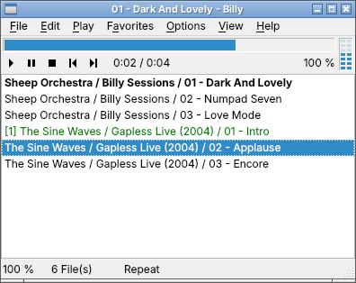
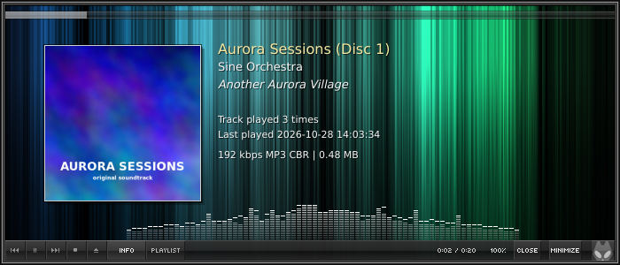
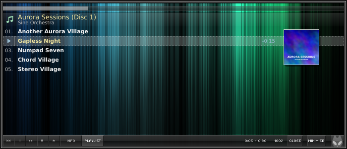

# Billy für Linux

Ein nativer Linux-Nachbau von **Billy**, dem kleinen „no nonsense“-Audioplayer aus der Windows-XP/Vista-Zeit
(Version 1.04l, 2004–2008, Sanne Schaap / Sheep Productions).

Billy spielt ganze Ordner voller Musik in Sekunden ab, **lückenlos (gapless)**, und lässt sich komplett per
Tastatur bedienen. Es gibt keine Tags, keine Skins und keine Bibliothek, sondern nur Dateinamen, eine Playlist und Musik.



## Was ist das genau?

Dieses Projekt ist eine **eigenständige Neuimplementierung** in C++17 mit Qt 6 und FFmpeg. Das Original war
ein Delphi-Programm auf Basis der BASS-Soundbibliothek. Aus der `Billy.exe` wurden nur Formular-Layouts, Menüs, Tastenkürzel,
INI-Schlüssel und Playlist-Formate ausgelesen. Der Programmcode ist komplett neu geschrieben. Code, Grafiken
und Dokumentation des Originals sind nicht enthalten: Laut Lizenz des Originals darf es nicht verändert werden,
und alle Rechte bleiben beim Autor.

## Funktionen

* **Gapless-Wiedergabe**: Ein Decoder-Thread hängt den nächsten Titel nahtlos an denselben Ausgabestrom an.
  FFmpeg entfernt Encoder-Delay und Padding (LAME/Xing-Header bei MP3, Pre-Skip bei Ogg/Opus, Editlists bei
  M4A). Hat der nächste Titel eine andere Samplerate, rechnet libswresample ihn auf die laufende Rate um, damit
  der Ausgabestrom nicht neu geöffnet werden muss.
  Getestet mit einem Sinuston, der auf drei Dateien aufgeteilt war: Die Titel ergeben hintereinander dekodiert
  wieder exakt die ursprüngliche Länge, ohne Lücke und ohne Knacken. Das gilt für WAV, FLAC, MP3 (CBR und
  VBR), Ogg Vorbis, Opus, AAC/M4A und für gemischte Sampleraten.
* Formate: alles, was FFmpeg dekodiert, darunter MP3/MP2/MP1, WAV, FLAC, Ogg Vorbis, Opus, AAC/M4A, ALAC,
  WMA, APE, WavPack, Musepack und AIFF. Sampelgenaues Springen in allen Formaten.
* **Internetradio**: „Add url“ (Ctrl+R) für Shoutcast-/Icecast-Streams (MP3, AAC, Ogg, Opus, HLS) und
  Senderlinks auf `.pls`/`.m3u`. Sendername und aktueller Titel werden aus den ICY- bzw. Ogg-Metadaten
  gelesen und im Fenstertitel, in der Statusleiste und über MPRIS angezeigt. Billy puffert 1,5 s vor, zeigt
  „Buffering…“ an, verbindet bei Abbrüchen neu und gibt nach 30 s ohne Daten mit „Lost connection“ auf.
  Sender lassen sich wie Dateien in Playlists und Favoriten speichern.
* Ordner öffnen (F4) oder hinzufügen (F3), mit oder ohne Unterordner, optional mit Datumsfilter
  (heute, letzte Woche, letzter Monat). Das Einlesen läuft im Hintergrund und lässt sich mit ESC abbrechen.
* Playmodes: Repeat list, Repeat file, Play list, Play file, Shuffle (mit Historie). Umschalten per F9 oder
  Klick auf die Statusleiste.
* Warteschlange (Insert / Numpad 9), Crop (Ctrl+Del), Duplikate oder fehlende Dateien entfernen,
  Liste mischen
* Ansicht als Dateiname, voller Pfad oder relativer Pfad zum Musikordner (F8)
* Finder: einfach lostippen
* Umbenennen (F2) mit Dateiinfos (Format, Bitrate, Länge, ID3v1/v2- bzw. Vorbis-Tags) und dem
  „R“-Aufräumknopf. **Mehrfach-Umbenenner** (F2 bei Mehrfachauswahl) mit Vorschau und den Codes
  `[case]`, `[upper]` und `[lower]`.
* Kalibrierte Pegelanzeigen: 7 LEDs (−60, −30, −15, −6, −3, −1 dB) oder 14 LEDs (−∞ bis 0 dB)
* Lautstärke durch Ziehen am „100 %“, mit Numpad +/− oder dem Mausrad. Softmute mit der Pause-Taste.
* Favoriten (Ctrl+D, Ctrl+B, Ctrl+1 … Ctrl+0), Playlists als txt, m3u oder pls laden und speichern
* F5 sucht neue Dateien in den geöffneten Ordnern (sortiert nach Dateidatum) und entfernt verschwundene
* Gesamtspielzeit der Auswahl (Ctrl+Alt+T), Sleep-Timer (Alt+T, optional mit Herunterfahren),
  „Copy to MP3 player“ (Ctrl+M)
* Statusleiste wie im Original: Anzahl Dateien, Playmode (klickbar) und rechts Format, Bitrate und Kanäle
  des gerade hörbaren Titels (z. B. „MP3 192 kbps Stereo“, „WAV 44100 Hz Stereo“)
* Tray-Icon (F11) mit dem Original-Menü (100 %/60 %/30 %/0 %, Play, Pause …)
* Farbschemata und Schrift für die Playlist (`*.billyscheme`)
* Automatisches Fortsetzen beim Start (optional), Single-Instance: Dateien aus dem Dateimanager landen im
  laufenden Billy
* **MPRIS2**: Die Medientasten der Tastatur und die Mediensteuerung des Desktops funktionieren systemweit.
  Das ersetzt die „globalen Hotkeys“ des Originals.
* Billy's love mode (Numpad 7) :)

Alle Tastenkürzel zeigt F1.

### Alternativer Look

Unter *View → Alternative look* (Ctrl+Shift+A) gibt es eine zweite, rahmenlose Oberfläche. Vorbild für Aufbau
und Maße ist der foobar2000-Skin *foo_Hydrangea* von lassekongo83; die Farben folgen einer dunklen Variante mit
Lichtstreifen. Bis auf die Alien-Katze (aus dem Skin, in Grau, siehe `data/skin/README.md`) ist alles mit
QPainter gezeichnet.




* Fenster 700×300 wie der Skin, Hintergrund aus vertikalen Lichtstreifen (Blau → Türkis → Grün)
* **Info-Seite**: das Cover (175 px; eingebettetes Bild oder `cover.jpg`, `folder.jpg` usw. im Ordner). Daneben stehen Album, Interpret, Titel (aus den Tags, sonst aus den
  Ordnernamen), „Track played N times“, „Last played …“ und das Format („192 kbps MP3 CBR | 4.85 MB“).
  Bei Internetradio stehen dort Sender, Interpret und Titel aus den Stream-Metadaten.
* **Spektrum-Analyzer** auf der Info-Seite, wie im Original von der Mitte aus gespiegelt: tiefe Frequenzen in
  der Mitte, der linke Kanal nach links, der rechte nach rechts; die äußeren Balken reagieren immer weniger auf
  die Lautstärke. 2048er FFT pro Kanal auf den gerade hörbaren Samples (mit der Ausgabelatenz verrechnet),
  logarithmische Bänder. Balken aus 1-px-Strichen, die nach oben deckender werden, mit fallenden Peak-Kappen.
* **Playlist-Seite**: Gruppen je Album mit Kopfzeile (Album und Interpret aus den Ordnernamen, so müssen keine
  Tags gelesen werden), Nummernspalte, ▶/❚❚ und Restzeit beim laufenden Titel, Cover neben jeder Gruppe
* Seekbar und Knopfreihe in Glas-Optik (heller Rand, glänzende obere und dunklere untere Hälfte) mit Pixelschrift: ⏮ ⏯ ⏭ ■ ⏏ (Ordner öffnen), INFO, PLAYLIST, Zeit,
  Lautstärke (ziehen oder Mausrad), CLOSE, MINIMIZE. Die **Alien-Katze** rechts unten öffnet das Menü
  (ein Rechtsklick auch).
* Fenster an einer freien Stelle verschieben, an den Kanten in der Größe ändern; jeder Look merkt sich seine
  eigene Fenstergröße.

Die Abspiel-Statistik liegt in `~/.config/Billy/PlayHistory.ini`.

### Nicht übernommen

| Original | Grund / Ersatz |
| --- | --- |
| Aufnahme von Internetradio | vielleicht später |
| last.fm-Scrobbling | die alte Audioscrobbler-API 1.2 gibt es nicht mehr |
| Update-Check auf sheepfriends.com | die Seite existiert nicht mehr |
| Dateizuordnungen in der Registry | stattdessen `billy.desktop` mit MIME-Typen |
| „Windows-Mixer zurücksetzen“ (Ctrl+Space) | setzt nur Billys eigene Lautstärke auf 100 % |
| Globale Hotkeys per RegisterHotKey | MPRIS (Medientasten, Desktop-Widgets, `playerctl`) |

## Bauen

Abhängigkeiten: CMake ≥ 3.16, ein C++17-Compiler, Qt 6 (Widgets, Multimedia, Network, optional DBus) und
FFmpeg (libavformat, libavcodec, libavutil, libswresample). Getestet mit Qt 6.4 und FFmpeg 6.1. Für FFmpeg 4.4
und 5.0 ist Kompatibilitätscode vorhanden, der ist aber noch nicht getestet.

```sh
# Debian / Ubuntu (24.04+)
sudo apt install build-essential cmake pkg-config qt6-base-dev qt6-multimedia-dev \
                 libavformat-dev libavcodec-dev libavutil-dev libswresample-dev

# Fedora (FFmpeg aus RPM Fusion, oder ffmpeg-free-devel)
sudo dnf install gcc-c++ cmake qt6-qtbase-devel qt6-qtmultimedia-devel ffmpeg-free-devel

# Arch
sudo pacman -S base-devel cmake qt6-base qt6-multimedia ffmpeg
```

```sh
cmake -S . -B build -DCMAKE_BUILD_TYPE=Release
cmake --build build -j
sudo cmake --install build      # optional: installiert billy, .desktop-Datei und Icon
```

Starten mit `./build/billy [Dateien, Ordner oder Playlists …]`.

## Konfiguration

Alles liegt in `~/.config/Billy/`:

* `Billy.ini`: Einstellungen (die Abschnitte heißen wie im Original `[General]`, `[Playlist]` usw.)
* `Playlist.txt`: die aktuelle Liste. Ist die Datei leer und schreibgeschützt, startet Billy immer mit
  leerer Liste, wie im Original.
* `Favorites/*.txt`, `Schemes/*.billyscheme`, `love.txt`

Ctrl+Alt+E öffnet den Ordner.

Debug-Ausgaben der Audio-Engine: `QT_LOGGING_RULES="billy.*.debug=true" billy`, FFmpeg-Meldungen
zusätzlich mit `BILLY_FFMPEG_LOG=1`.

## Aufbau des Codes

```
src/audio/Decoder.*       FFmpeg-Decoder (Stereo-Float, Resampling, Streams mit ICY-Metadaten), Datei-Infos und Tags
src/audio/AudioEngine.*   Decoder-Thread, Puffer (Standard 3000 ms), Gapless-Übergänge, Stream-Puffer,
                          Ausgabe-Thread mit QAudioSink
src/PlaylistModel.*       Playlist, Queue, Shuffle-Historie, Playmodes, Laden/Speichern, Ordner-Scan, Sortierung
src/MainWindow.*          Hauptfenster, Aktionen und Tastenkürzel, Numpad, Tray, Pegelanzeige
src/widgets/              SheepProgress (Balken und LED-Meter), Playlist-Ansicht, Button-Glyphen
src/dialogs/              Finder, Umbenennen, Mehrfach-Umbenenner, Ordnerauswahl, Favoriten, Einstellungen, …
src/Mpris.*               MPRIS2 über D-Bus
```

Zur Audioausgabe: Ein explizit gestarteter Titel (Enter, Doppelklick) läuft in seiner eigenen Samplerate, also
bitgenau. Alle direkt folgenden Titel laufen in derselben Rate weiter und werden bei Bedarf umgerechnet.

### Warum nicht BASS?

BASS (un4seen) gibt es auch für Linux, ist aber closed source und nur für nicht-kommerzielle Nutzung frei.
Die Bibliothek darf nicht mit ins Repository und nicht in Distributionspakete. FFmpeg ist frei (LGPL), in
jeder Distribution enthalten und deckt Formate, Gapless, Resampling und Streams ab.
